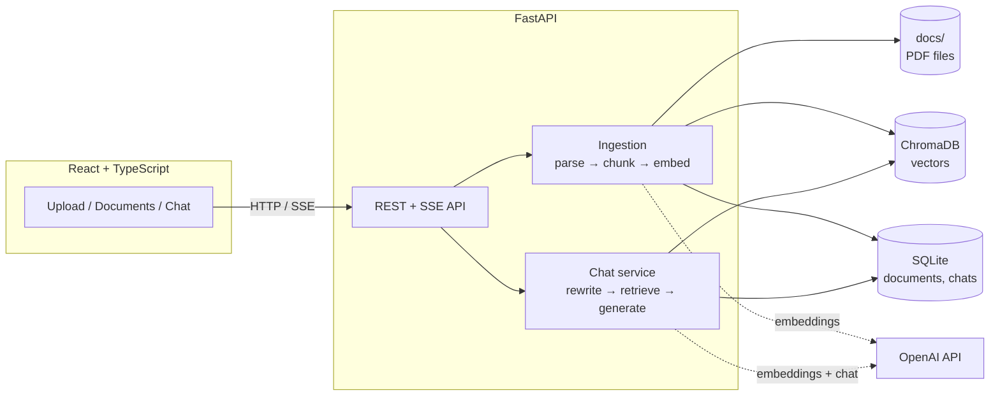

# 📄 PaperTrail

**Ask questions about your PDFs and get answers that cite their sources.**

PaperTrail is a retrieval-augmented generation (RAG) app. You drag in PDFs and the backend parses, chunks and embeds them into a vector database. You then chat with your documents. Each answer cites the excerpts it was built from, and every citation opens the source PDF at the right page.

The RAG pipeline is written directly, without LangChain or LlamaIndex, so that every step (parsing, chunking, embedding, retrieval, query rewriting, prompting) is visible and testable.

## Features

- **Drag-and-drop PDF upload** with background ingestion and live status (processing / ready / failed)
- **Grounded answers with inline citations** `[1]`. Each citation links to the PDF page it came from.
- **Multi-turn chat**: follow-ups like *"what about the second one?"* are rewritten into standalone search queries
- **Token streaming** over Server-Sent Events
- **Conversation history** persisted in SQLite and reloadable from the sidebar
- **Duplicate detection** by SHA-256 hash, and clean deletion of a file and its vectors
- **Retrieval evaluation harness** (hit@k, MRR) for tuning chunking and retrieval settings
- **Offline demo mode** so the UI can run without an OpenAI key

## Architecture



### Ingestion
1. `POST /api/documents` checks the upload (extension, `%PDF-` magic bytes, size limit), hashes it to catch duplicates, saves it to `docs/` and returns `202 Accepted` right away.
2. A background task extracts text **page by page** with PyMuPDF, using its layout blocks as paragraph boundaries.
3. The **chunker** packs paragraphs into chunks of about 600 tokens with about 100 tokens of overlap. Paragraphs that are too large are split at sentence boundaries, and as a last resort at token boundaries. Each chunk keeps its page range.
4. Chunks are embedded with `text-embedding-3-small` (prefixed with the document name) and stored in ChromaDB with `{doc_id, filename, page_start, page_end}` metadata.

### Question answering
1. Load the most recent messages of the conversation.
2. **Query rewriting**: if there is history, the LLM rewrites the new message into a standalone question. Retrieval on "what about its limitations?" would otherwise miss.
3. Embed the query and take the top-k chunks from Chroma by cosine similarity, dropping anything below a relevance floor.
4. Prompt the LLM with numbered excerpts and an instruction to answer only from them, cite `[n]`, and say so when the answer isn't there.
5. Stream the tokens to the browser, then save both messages and their sources.

## Design decisions

| Decision | Why |
|---|---|
| **Hand-written pipeline** instead of LangChain/LlamaIndex | Every step is explicit, debuggable and unit-tested. Interchangeable parts sit behind small `Protocol`s (`Embedder`, `LLM`). |
| **Token-based chunking with paragraph awareness** | Token counts map directly onto model limits. Respecting paragraph and sentence boundaries keeps chunks coherent, and overlap protects facts that straddle a boundary. |
| **Page numbers carried through to citations** | Grounding you can check is the main way users come to trust a RAG answer. |
| **Query rewriting for follow-ups** | Retrieval is stateless. Without rewriting, pronouns in follow-up questions retrieve the wrong chunks. |
| **Chroma for vectors, SQLite for everything else** | The vector DB is a search index. Document status, errors and chat history are relational data that need a source of truth. |
| **Embeddings computed by the app, not Chroma** | The embedding model is explicit and configurable, and tests can inject a fake embedder. |
| **Background ingestion and status polling** | Uploads return immediately, large PDFs don't block the request, and failures surface per document. |
| **Server-Sent Events for streaming** | Simpler than WebSockets for one-way token streams, and it works through standard proxies (nginx is configured with `proxy_buffering off`). |
| **App factory with dependency injection** | `create_app(settings, embedder=..., llm=...)` lets the whole API run in tests with no network. |

## Getting started

### Prerequisites
- Python 3.11+ and [uv](https://docs.astral.sh/uv/)
- Node.js 20+
- An OpenAI API key

### Run locally

```bash
cp .env.example .env          # then put your OPENAI_API_KEY in .env

# Terminal 1: API on http://localhost:8000 (Swagger docs at /docs)
cd backend
uv sync
uv run uvicorn app.main:create_app --factory --reload --port 8000

# Terminal 2: UI on http://localhost:5173
cd frontend
npm install
npm run dev
```

Uploaded PDFs are stored in `docs/`. The vector index and the SQLite database are in `data/`.

### Run with Docker

```bash
cp .env.example .env          # add your key
docker compose up --build
```

Then open http://localhost:8080. nginx serves the built UI and proxies `/api` to the backend.

### Offline demo (no API key)

```bash
cd backend
uv run python scripts/offline_demo.py
```

This uses fake bag-of-words embeddings and a canned "LLM" response, so you can try the UI flow without spending tokens.

## Configuration

All settings come from environment variables or `.env` (see [`.env.example`](.env.example)):

| Variable | Default | Purpose |
|---|---|---|
| `OPENAI_API_KEY` | (none) | Required for real embeddings and answers |
| `CHAT_MODEL` | `gpt-4.1-mini` | Model used for answers and query rewriting |
| `EMBEDDING_MODEL` | `text-embedding-3-small` | Embedding model (re-index if changed) |
| `CHUNK_SIZE_TOKENS` / `CHUNK_OVERLAP_TOKENS` | `600` / `100` | Chunking |
| `TOP_K` | `6` | Chunks retrieved per question |
| `MIN_RELEVANCE` | `0.2` | Cosine-similarity floor for retrieved chunks |
| `HISTORY_MESSAGES` | `8` | Previous messages sent with each question |

## API

Interactive docs are at `http://localhost:8000/docs`.

| Method | Path | Description |
|---|---|---|
| `POST` | `/api/documents` | Upload a PDF (multipart). Returns `202`; ingestion runs in the background |
| `GET` | `/api/documents` | List documents and their status |
| `GET` | `/api/documents/{id}` | Document details |
| `GET` | `/api/documents/{id}/file` | Serve the original PDF (append `#page=N` in the browser) |
| `DELETE` | `/api/documents/{id}` | Delete the file, its vectors and its record |
| `POST` | `/api/chat` | `{question, conversation_id?}` → SSE stream: `meta`, `sources`, `token`…, `done` / `error` |
| `GET` | `/api/conversations` | List conversations |
| `GET` | `/api/conversations/{id}` | Conversation with messages and sources |
| `DELETE` | `/api/conversations/{id}` | Delete a conversation |
| `GET` | `/api/health` | Status, configured models, indexed chunk count |

## Testing and evaluation

```bash
cd backend
uv run pytest
```

The tests cover the chunker (size limits, overlap, page tracking, oversized paragraphs) and the full API (upload, dedup, failed ingestion, deletion, retrieval, streaming, and follow-up query rewriting with history). They use fake embedders and LLMs, so they need no network.

**Retrieval evaluation.** Copy [`eval/golden.example.json`](eval/golden.example.json) to `eval/golden.json` and write questions about your own documents, noting where each answer is. Then run:

```bash
cd backend
uv run python ../eval/run_eval.py ../eval/golden.json --answers
```

It reports **hit@k** and **MRR** for retrieval, plus an optional check that answers contain expected phrases. Use it to compare chunk sizes, overlap, `top_k` or embedding models with numbers rather than by feel.

## Project structure

```
backend/
  app/
    api/          FastAPI routers (documents, chat, conversations)
    ingestion/    PDF parsing, chunking, ingestion pipeline
    retrieval/    embedder, Chroma vector store, retriever
    llm/          OpenAI chat client and prompts
    services/     multi-turn chat orchestration
    db/           SQLModel tables and engine
    config.py     settings
    main.py       app factory
  scripts/        offline demo server
  tests/
frontend/
  src/
    api.ts        typed API client + SSE stream parser
    components/   upload zone, document list, conversations, chat message
    App.tsx
eval/             retrieval evaluation harness
docs/             uploaded PDFs (gitignored)
data/             ChromaDB + SQLite (gitignored)
```

## Limitations and roadmap

- PDFs with a text layer only. Scanned PDFs would need OCR (for example Tesseract).
- Single user, no authentication.
- Possible next steps:
  - Hybrid search (BM25 + vectors) and a cross-encoder reranker
  - LLM-as-judge faithfulness scoring in the eval harness
  - More file types (DOCX, Markdown, HTML)
  - Cloud deployment with object storage for files
